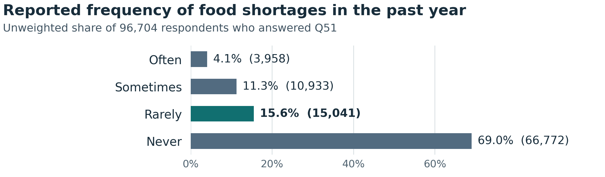
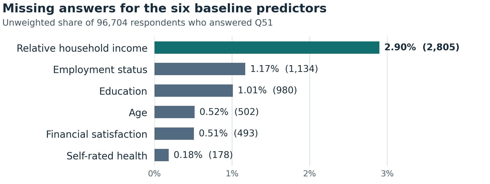

# Data preparation for reported food shortages

[Download the editable Word section with both figures](Q51_data_preparation.docx?raw=1)

These figures accompany Section 3, Data Preparation. Both use the 96,704 respondents who answered World Values Survey question Q51. The percentages describe the pooled, unweighted sample.

## How often did respondents report going without enough food?



**Figure 1.** The choice is where to put the 15,041 people who answered “rarely”. Counting “often” and “sometimes” gives 14,891 positive examples (15.40%). Including “rarely” gives 29,932 (30.95%). The group has chosen Q51 and still needs to confirm the grouping.

## Which questions had the most missing answers?



**Figure 2.** Relative household income was the question most often skipped (2.90%). A respondent can appear in several bars. Requiring all six answers would remove 5,107 people (5.28%) and leave 91,597. Missing-answer flags allow all 96,704 to be retained.

## Source and reproduction

The figures use the [counts by survey sample](../q51_by_country.csv) from [World Values Survey Wave 7, v6.0.0](https://doi.org/10.14281/18241.24). The [member log](../log.md) records the cleaning and weighting checks.

To regenerate both 300 dpi PNGs, run the following command from the repository root with pandas and Matplotlib installed.

```bash
python work/muscat/report/make_figures.py
```
