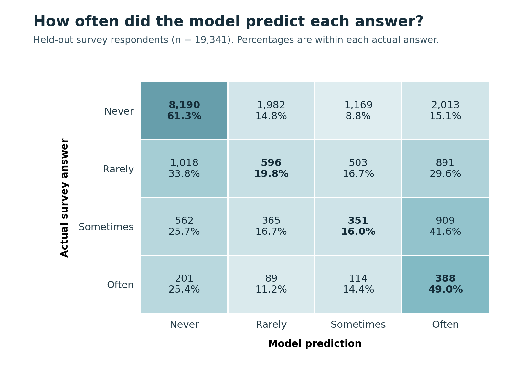

# Predicting how often a family went without enough food

Matthias Muscat · ICS5110 · World Values Survey Wave 7, Q51

The logistic regression correctly predicted the reported answer for **9,525 of 19,341** held-out respondents. It improved on always guessing “never” when all four answers counted equally. It struggled particularly with “sometimes”. Of the 2,187 people who gave that answer, it predicted “often” for 909 and “sometimes” for 351.

## Results on the held-out survey data

| Measure | Logistic regression | Always predict “never” |
|---|---:|---:|
| Macro-F1 (primary, higher is better) | **0.304** | 0.204 |
| Accuracy | 49.25% | 69.05% |
| Average recall across the four answers | 36.55% | 25.00% |
| Mean error in answer categories (lower is better) | 0.877 | 0.505 |

“Never” accounted for 69.05% of the test set. Always choosing it gives high accuracy and misses every respondent in the three remaining categories. Macro-F1 gives each of the four answers equal weight and takes both missed cases and incorrect predictions into account.

| Actual answer | Respondents | Correct | Recall | Precision | F1 |
|---|---:|---:|---:|---:|---:|
| Never | 13,354 | 8,190 | 61.3% | 82.1% | 0.702 |
| Rarely | 3,008 | 596 | 19.8% | 19.7% | 0.197 |
| Sometimes | 2,187 | 351 | 16.0% | 16.4% | 0.162 |
| Often | 792 | 388 | 49.0% | 9.2% | 0.155 |

Read the graph across a row to see where the model placed people who gave that answer. For “often”, **recall** means it found 388 of the 792 people who reported it. **Precision** means only 388 of its 4,201 “often” predictions were correct.

## How the experiment was run

The inputs were age, education, employment, household income level, satisfaction with household finances and self-rated health, encoded into 18 numeric columns. The output was the respondent’s reported food-shortage frequency in the preceding 12 months. The 96,704 eligible respondents came from 66 survey samples. The test therefore measures performance on other people in the participating samples. Performance in an unseen country or future survey wave remains untested.

After sorting by source row, a stratified 80/20 split (seed 42) reserved 19,341 people for testing. Five-fold stratified validation used only the other 77,363. Each fold fitted its own scaler. We compared four regularisation settings with and without extra weight for rarer answers. Balanced class weights and `C=10` gave the highest mean validation macro-F1 (0.30524), essentially level with balanced `C=1` (0.30523). The selected setting was refitted on all 77,363 training respondents before testing. Primary results give each test respondent equal weight. A separate check using the survey weights (`W_WEIGHT × S018`) gave macro-F1 of 0.299 for logistic regression and 0.203 for the baseline.

## Secondary analysis of recurring shortages

The four-category predictions above remain the main result. For a separate alert, we added the model scores for “sometimes” and “often”. We assigned two illustrative cost units to a missed recurring shortage and one to a false alarm. Out-of-fold training scores selected a cutoff of 0.65. These costs describe the comparison scenario.

| Test group and cutoff | Actual recurring cases | Cases identified | Cases missed | False alarms | Illustrative cost |
|---|---:|---:|---:|---:|---:|
| All respondents, 0.50 | 2,979 | 1,903 | 1,076 | 5,247 | 7,399 |
| All respondents, 0.65 | 2,979 | 772 | 2,207 | 1,124 | 5,538 |
| Age 65 or over, 0.50 | 233 | 114 | 119 | 328 | 566 |
| Age 65 or over, 0.65 | 233 | 35 | 198 | 53 | 449 |

The 0.65 cutoff reduced false alarms but missed 74.1% of recurring cases overall and 85.0% among respondents aged 65 or over. The older group included 2,390 test respondents with a recorded age.

## Review or reproduce

Open the notebook to see the executed cells and the results. To rerun it, follow the member guide to obtain or rebuild the private CSV and select **Run All**. Other techniques can use the same respondents, folds and measures for a direct comparison.

[Executed notebook](../../../../03_code/03_logistic_regression_muscat.ipynb) · [All scores, counts and split fingerprints](metrics.json) · [Fitted model parameters](model.json) · [Private data access and rebuild](../../README.md) · [Experiment log](../../log.md)
